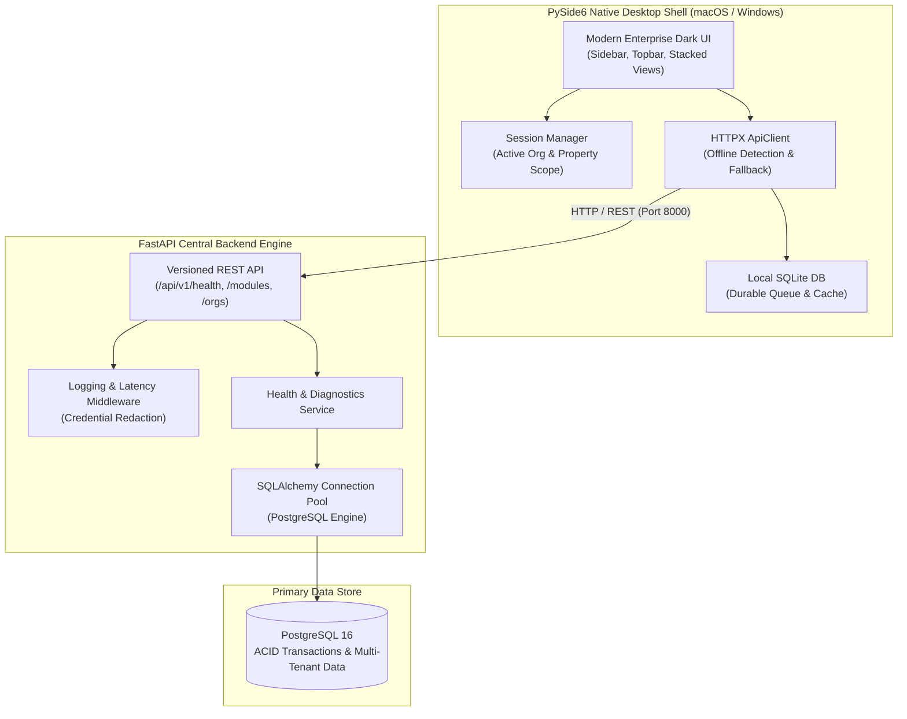

# Victory Crest ONE — System Architecture

## 1. Architectural Philosophy

Victory Crest ONE is designed as a unified enterprise business operating system rather than a collection of disparate tools. The core architecture guarantees:

1. **Explicit Transaction Boundaries**: Cross-module flows (such as Reservation -> Guest Folio -> Restaurant Order -> Payment -> General Ledger) occur through traceable, balance-validated operations.
2. **Strict Multi-Tenant Scoping**: All records carry `organization_id` and, where applicable, `property_id`. Unauthorised cross-tenant queries are blocked at the database and service layer.
3. **Resilient Local & Offline Operation**: A central PostgreSQL instance serves as the canonical source of truth, while an offline SQLite database and durable operation queue allow local work during connectivity lapses without silent conflict overwrites.
4. **Clean Domain Separation**: Clear boundaries between Presentation (PySide6), REST API Layer (FastAPI), Business Services, Data Access (SQLAlchemy), and Background Schedulers.



## 2. Multi-Tenant Organizational Hierarchy

```text
Victory Crest Enterprise Group (Organisation)
 ├── GrandVista Heritage Hotel — Madurai (Property: Hotel)
 ├── GrandVista Mountain Resort — Kodaikanal (Property: Resort)
 ├── GrandVista Business Hotel — Chennai (Property: Business Hotel)
 └── Victory Crest Corporate HQ (Property: Corporate Office)
```

Each Property possesses independent inventory, folios, room allocations, POS registers, and department budgets, with roll-up consolidated reporting at the Organisation level.

## 3. Decimal-Safe Arithmetic

All monetary and rate calculations strictly utilize `Decimal` arithmetic (`shared/calculations.py`) to prevent binary floating-point rounding errors in general ledger, invoicing, and rate calculations:
- `Occupancy Rate`: Protected against zero available sellable rooms.
- `ADR & RevPAR`: Explicit handling of zero rooms sold or available.
- `Gross Profit & Variance`: Decimal precision rounded half-up to 2 places.
